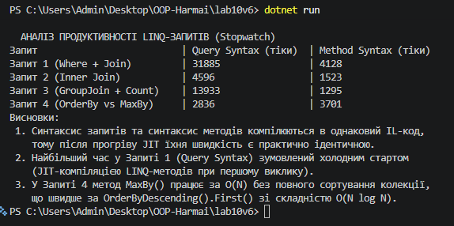

# Лабораторна робота №10: LINQ в дії — фільтри, join, агрегації та продуктивність

##  Тема
LINQ в дії: фільтри, join, агрегації. Продуктивність.

##  Мета роботи
Навчитися ефективно використовувати LINQ для фільтрації, об'єднання (`join`) та агрегації даних, а також аналізувати продуктивність LINQ-запитів за допомогою `Stopwatch`.

##  Індивідуальний варіант №6
* **Сутності:**
  * `Director (Id, Name, Country)` — 10 тестових записів.
  * `Movie (Id, Title, DirectorId, ReleaseYear)` — 18 тестових записів.
* **Реалізовані запити (у синтаксисі запитів та синтаксисі методів):**
  1. Пошук усіх фільмів режисера `"Christopher Nolan"`, випущених після `2000` року (`Join` + `Where`).
  2. Об'єднання фільмів з їхніми режисерами з виведенням назви фільму та імені режисера (`Join` + `Select`).
  3. Підрахунок кількості фільмів для кожного режисера (`GroupJoin` + `Count`).
  4. Пошук найновішого фільму у колекції (`OrderByDescending().FirstOrDefault()` та `MaxBy()`).

## хід роботи
 **Реалізація запитів та замір часу:** Усі 4 запити реалізовано двома способами (Query Syntax та Method Syntax) з обов'язковою матеріалізацією та заміром часу через `System.Diagnostics.Stopwatch`.
 **Аналіз продуктивності:**
   - Обидва синтаксиси LINQ компілюються в ідентичний IL-код, тому після прогріву JIT показують однаковий рівень швидкодії.
   - Найбільший час при першому виклику пояснюється витратами на JIT-компіляцію LINQ-методів («холодний старт»).
   - Однопрохідний метод агрегації `MaxBy()` ($O(N)$) виявився швидшим за повне сортування `OrderByDescending().FirstOrDefault()` ($O(N \log N)$).
