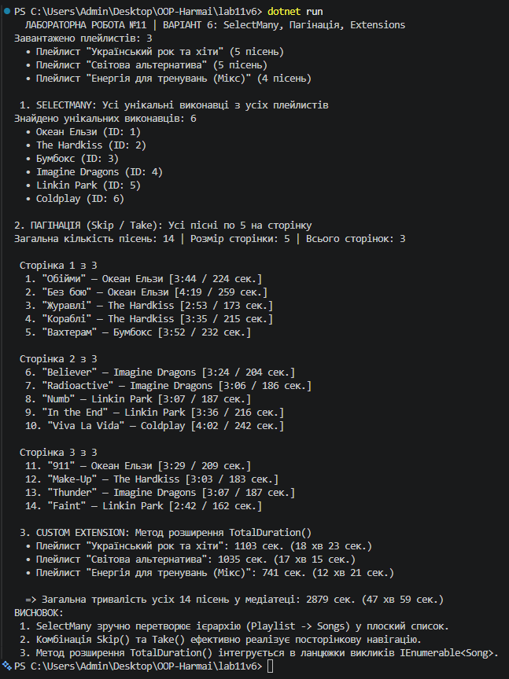

# Лабораторна робота №11: LINQ — SelectMany, пагінація й custom extensions

##  Тема
LINQ: `SelectMany`, пагінація й custom extensions.

## Мета роботи
Навчитися використовувати оператор `SelectMany` для роботи з вкладеними колекціями, реалізовувати пагінацію даних за допомогою LINQ (`Skip`, `Take`), а також створювати власні методи розширення для `IEnumerable<T>`.

---

##  Індивідуальний варіант №6 (Плейлисти та пісні з виконавцями)
* **Сутності:**
  * `Artist (Id, Name)` — 6 виконавців.
  * `Song (Id, Title, DurationSeconds, Artist)` — 14 пісень.
  * `Playlist (Id, Name, List<Song> Songs)` — 3 плейлисти з вкладеними колекціями пісень.
* **Реалізовані завдання:**
  1. **`SelectMany`:** Отримання всіх унікальних виконавців з усіх плейлистів (`SelectMany` + `Select` + `Distinct`).
  2. **Пагінація:** Посторінкове виведення всіх пісень по 5 треків на сторінку за допомогою `Skip()` та `Take()`.
  3. **Custom Extension:** Метод розширення `TotalDuration()` для `IEnumerable<Song>`, що обчислює сумарну тривалість пісень у секундах.

---

## 🛠️ Короткий хід роботи
 **Розгортання колекцій (`SelectMany`):** Перетворено ієрархію плейлистів у єдиний список треків та виділено унікальних виконавців **Реалізація пагінації:** Виконано розбиття списку з 14 пісень на 3 сторінки по 5 елементів.
  **Створення методу розширення:** Реалізовано клас `SongCollectionExtensions` з методом `TotalDuration()` та перевірено його роботу як для окремих плейлистів, так і для всієї бібліотеки.

