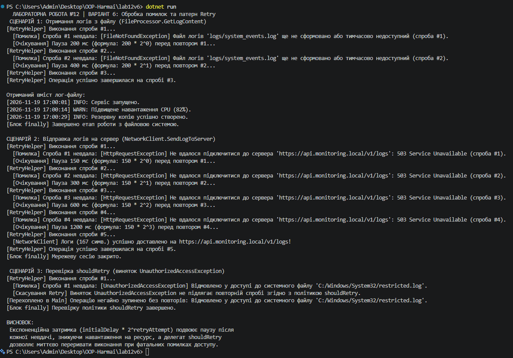

# Лабораторна робота №12: Обробка файлових/мережевих помилок та патерн Retry

##  Тема
Обробка файлових/мережевих помилок та патерн Retry.

##  Мета роботи
Навчитися обробляти типові помилки вводу/виводу та мережеві помилки за допомогою блоків `try-catch-finally`, а також реалізувати патерн Retry з експоненційною затримкою для підвищення відмовостійкості застосунків.

---

##  Індивідуальний варіант №6 (Відправка логів)
* **`FileProcessor.GetLogContent(string path)`:** Імітує `FileNotFoundException` перші 2 рази, після чого успішно повертає вміст логів.
* **`NetworkClient.SendLogToServer(string url, string logContent)`:** Імітує `HttpRequestException` перші 4 рази, після чого успішно відправляє логи на сервер.
* **`RetryHelper.ExecuteWithRetry<T>(...)`:** Узагальнений клас із експоненційною затримкою (`initialDelay * 2^retryAttempt`), логуванням кожної спроби та вибірковою політикою повторів `shouldRetry` (для `FileNotFoundException` та `HttpRequestException`).

---

##  Короткий хід роботи та висновок

 **Реалізація сервісів та `RetryHelper`:** Створено класи `FileProcessor`, `NetworkClient` та статичний клас `RetryHelper` з підтримкою експоненційної затримки та делегата `shouldRetry`.
 **Демонстрація в `Main`:** Перевірено відновлення після тимчасових збоїв для обох сервісів, а також негайне переривання операції при фатальній помилці `UnauthorizedAccessException`.
**Висновок:** Експоненційна затримка подвоює інтервал очікування після кожної невдачі (`initialDelay * 2^retryAttempt`), що дозволяє уникнути перевантаження нестабільного сервера чи файлової системи та дає ресурсу час на відновлення.

