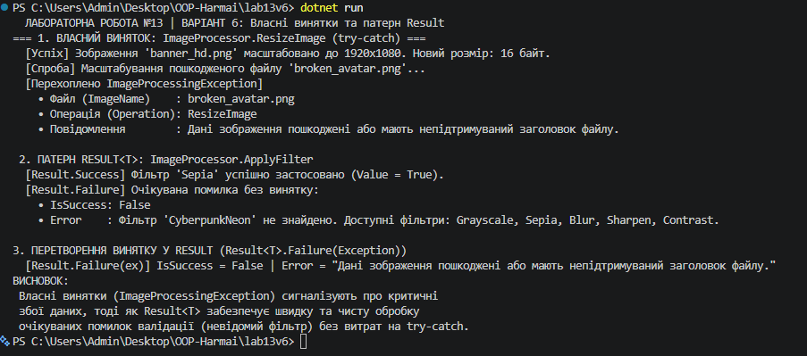

# Лабораторна робота №13: Власні винятки та патерн Result

##  Тема
Власні винятки та патерн Result.

##  Мета роботи
Навчитися створювати власні типи винятків для специфічних помилок предметної області, а також реалізовувати патерн `Result<T>` для контрольованої обробки очікуваних сценаріїв невдачі без використання винятків.

---

##  Індивідуальний варіант №6 (Обробка зображень)
* **Власний виняток `ImageProcessingException`:** Успадкований від `Exception`, містить стандартні конструктори та властивості `ImageName` і `Operation`.
* **Узагальнений клас `Result<T>`:** Містить властивості `IsSuccess`, `Value`, `Error`, приватний конструктор та фабричні методи `Success(T)`, `Failure(string)` і `Failure(Exception)`.
* **Сервіс `ImageProcessor`:**
  * `ResizeImage(...)` — викидає `ImageProcessingException`, якщо дані зображення пошкоджені або розміри некоректні.
  * `ApplyFilter(...)` — повертає `Result<bool>.Success(true)` або `Result<bool>.Failure(...)` при вказанні невідомого фільтра.

---

## 🛠️ Короткий хід роботи та висновок

 **Реалізація винятку та `Result<T>`:** Створено клас `ImageProcessingException` та узагальнений контейнер `Result<T>`.
 **Реалізація `ImageProcessor` та демонстрація в `Main`:** Перевірено перехоплення критичних збоїв через `try-catch` при масштабуванні зображення та обробку очікуваних помилок вибору фільтра через `IsSuccess` і `Error`.
 **Висновок:** Винятки виправдані для виняткових збоїв цілісності даних (`ResizeImage`), тоді як патерн `Result<T>` робить код передбачуваним, продуктивним і чистим у штатних сценаріях валідації (`ApplyFilter`).

