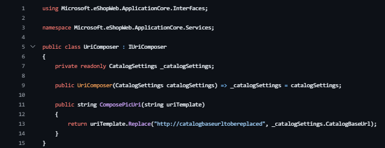
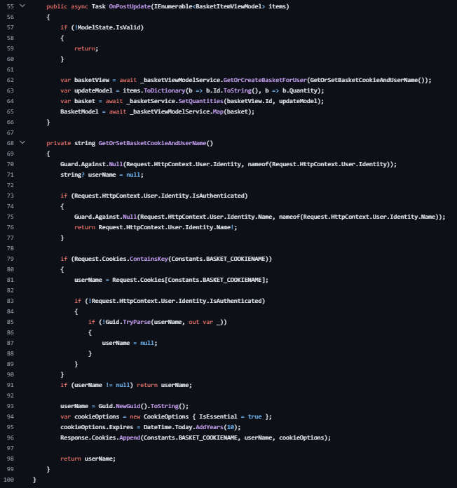
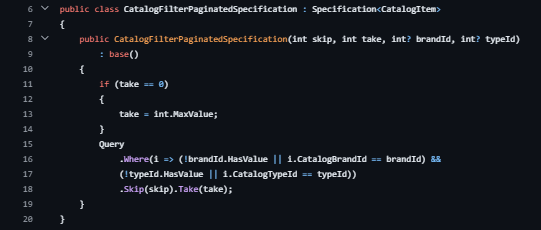
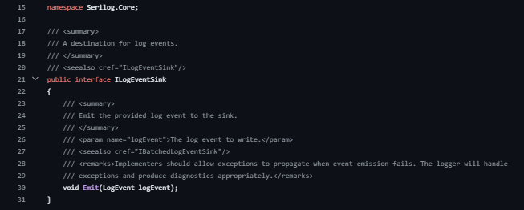

# Лабораторна робота №14: Аналіз SRP/OCP у відкритих репозиторіях

## Мета роботи
Дослідити практичне застосування принципів єдиної відповідальності (**SRP** — Single Responsibility Principle) та відкритості/закритості (**OCP** — Open/Closed Principle) у реальних open-source проєктах на C#, проаналізувати переваги й ризики архітектурних рішень та запропонувати рефакторинг.

---

## Обрані open-source репозиторії (різні предметні області)

1. **eShopOnWeb** (`https://github.com/dotnet-architecture/eShopOnWeb`)
   * **Домен:** Електронна комерція (E-Commerce / еталонний вебзастосунок на базі ASP.NET Core та Clean Architecture).
2. **Serilog** (`https://github.com/serilog/serilog`)
   * **Домен:** Інфраструктурна бібліотека структурного логування та діагностики застосунків .NET.

---

## 1. Приклади вдалого застосування SRP (Single Responsibility Principle)

### Приклад 1.1: Клас `UriComposer` (Репозиторій `eShopOnWeb`)
* **Посилання на файл:** [`src/ApplicationCore/Services/UriComposer.cs`](https://github.com/dotnet-architecture/eShopOnWeb/blob/main/src/ApplicationCore/Services/UriComposer.cs) (рядки 5–15)
* **Де в коді видно принцип:**
  Клас `UriComposer` реалізує інтерфейс `IUriComposer` і містить єдиний метод `ComposePicUri(string uriTemplate)`, який замінює плейсхолдер базової URL-адреси зображення на актуальний шлях із налаштувань (`_catalogSettings.CatalogBaseUrl`).
* **Переваги для підтримки:**
  Клас має лише одну причину для зміни — зміну правил формування URL-адрес медіафайлів. Його легко тестувати ізольовано без підняття вебсервера чи бази даних.
* **Що зміниться при додаванні нової функції:**
  Якщо знадобиться додати підтримку CDN або змінити шаблон шляху до картинок, зміни торкнуться виключно цих 15 рядків коду без ризику зламати логіку каталогу чи кошика.



---

### Приклад 1.2: Клас `PropertyEnricher` (Репозиторій `Serilog`)
* **Посилання на файл:** [`src/Serilog/Core/Enrichers/PropertyEnricher.cs`](https://github.com/serilog/serilog/blob/main/src/Serilog/Core/Enrichers/PropertyEnricher.cs) (рядки 18–58)
* **Де в коді видно принцип:**
  Клас `PropertyEnricher` відповідає виключно за одну операцію — додавання однієї конкретної властивості (`LogEventProperty`) до події логування `LogEvent` у методі `Enrich(LogEvent logEvent, ILogEventPropertyFactory propertyFactory)`.
* **Переваги для підтримки:**
  Максимально атомарний, передбачуваний та потокобезпечний компонент. Він не знає ні про те, звідки береться лог, ні про те, куди він буде записаний (файл, консоль чи мережа).
* **Що зміниться при додаванні нової функції:**
  У разі зміни правил перезапису існуючих властивостей події (параметр `destructureObjects`) редагується лише цей маленький клас, а всі інші збагачувачі логів (MachineName, ThreadId тощо) залишаються незмінними.

---

## 2. Приклади порушення SRP (Single Responsibility Principle)

### Приклад 2.1: PageModel `IndexModel` кошика (Репозиторій `eShopOnWeb`)
* **Посилання на файл:** [`src/Web/Pages/Basket/Index.cshtml.cs`](https://github.com/dotnet-architecture/eShopOnWeb/blob/main/src/Web/Pages/Basket/Index.cshtml.cs) (рядки 18–92)
* **Де в коді видно порушення:**
  Клас `IndexModel` (рівень представлення Razor Pages) поєднує одразу 4 різні відповідальності:
  1. Обробка HTTP-запитів (`OnGet`, `OnPost`, `OnPostUpdate`).
  2. Ідентифікація користувача та керування HTTP-куками для анонімних покупців (`GetOrSetBasketCookieAndUserName()`, рядки 74–91).
  3. Пряма робота з доменним сервісом кошика (`_basketService.AddItemToBasket`, `SetQuantities`).
  4. Мапінг доменної сутності у ViewModel (`_basketViewModelService.GetOrCreateBasketForUser`).
* **Ризики для підтримки:**
  Будь-яка зміна політики безпеки кук (наприклад, зміна терміну дії `Expires` чи прапорця `HttpOnly`) змушує редагувати UI-клас сторінки кошика. Крім того, логіку визначення анонімного користувача неможливо перевикористати на інших сторінках без дублювання коду.
* **Що зміниться при додаванні нової функції:**
  Якщо з'явиться вимога прив'язувати анонімний кошик не через Cookie, а через JWT-токен або заголовок запиту, доведеться змінювати код контролера/сторінки замість заміни одного сервісу ідентифікації.



---

### Приклад 2.2: Клас конфігурації `LoggerConfiguration` (Репозиторій `Serilog`)
* **Посилання на файл:** [`src/Serilog/LoggerConfiguration.cs`](https://github.com/serilog/serilog/blob/main/src/Serilog/LoggerConfiguration.cs) (рядки 26–320)
* **Де в коді видно порушення:**
  `LoggerConfiguration` виступає як центральний «God-Builder», який одночасно зберігає стан та налаштовує: приймачі логів (`_logEventSinks`), аудит-приймачі (`_auditSinks`), збагачувачі (`_enrichers`), фільтри (`_filters`), політики деструктуризації (`_additionalDestructuringPolicies`), рівні логування та містить складну фабричну логіку побудови фінального конвеєра у методі `CreateLogger()` (рядки 230–315).
* **Ризики для підтримки:**
  Клас має велику кількість причин для змін: додавання нового механізму фільтрації, зміна логіки аудит-логів або зміна правил деструктуризації об'єктів призводять до модифікації одного й того самого файлу.
* **Що зміниться при додаванні нової функції:**
  При додаванні нового етапу в конвеєр обробки `LogEvent` (наприклад, асинхронної буферизації на рівні ядра) доведеться вносити зміни як у поля конфігуратора, так і в складну логіку складання об'єктів усередині `CreateLogger()`.

---

## 3. Приклади розширення за OCP (Open/Closed Principle)

### Приклад 3.1: Патерн Specification для запитів до БД (Репозиторій `eShopOnWeb`)
* **Посилання на файл:** [`src/ApplicationCore/Specifications/CatalogFilterPaginatedSpecification.cs`](https://github.com/dotnet-architecture/eShopOnWeb/blob/main/src/ApplicationCore/Specifications/CatalogFilterPaginatedSpecification.cs) (рядки 5–19) та інтерфейс [`IReadRepository<T>`](https://github.com/dotnet-architecture/eShopOnWeb/blob/main/src/ApplicationCore/Interfaces/IReadRepository.cs)
* **Де в коді видно принцип:**
  Замість додавання десятків методів у репозиторій (`GetByBrand`, `GetByTypeAndPage` тощо), репозиторій приймає абстракцію `ISpecification<T>`. Кожен новий критерій фільтрації чи пагінації оформлюється як окремий клас-спадкоємець `Specification<CatalogItem>`.
* **Переваги для підтримки:**
  Клас репозиторію є повністю **закритим для модифікації**, але система **відкрита для розширення** новими складними SQL/LINQ-запитами.
* **Що зміниться при додаванні нової функції:**
  Щоб додати, наприклад, фільтрацію товарів за діапазоном цін та рейтингом, розробник просто створює новий клас `CatalogPriceRangeSpecification.cs`, не змінюючи жодного рядка в існуючих репозиторіях чи сервісах.



---

### Приклад 3.2: Плагінна архітектура приймачів логів `ILogEventSink` (Репозиторій `Serilog`)
* **Посилання на файл:** [`src/Serilog/Core/ILogEventSink.cs`](https://github.com/serilog/serilog/blob/main/src/Serilog/Core/ILogEventSink.cs) (рядки 16–27) та використання у [`src/Serilog/Core/Sinks/SafeAggregateSink.cs`](https://github.com/serilog/serilog/blob/main/src/Serilog/Core/Sinks/SafeAggregateSink.cs) (рядки 22–48)
* **Де в коді видно принцип:**
  Ядро бібліотеки працює виключно з абстракцією `ILogEventSink`, що має єдиний метод `void Emit(LogEvent logEvent)`. Усі реальні способи збереження логів (Console, File, Seq, Elasticsearch, Telegram) реалізуються як зовнішні плагіни-спадкоємці цього інтерфейсу.
* **Переваги для підтримки:**
  Ядро `Serilog` не залежить від сторонніх бібліотек запису у файли чи мережу, що гарантує стабільність та відсутність регресій при розвитку екосистеми.
* **Що зміниться при додаванні нової функції:**
  Для відправки логів у нове сховище (наприклад, у Kafka або хмарну базу даних) достатньо створити новий клас, що реалізує `ILogEventSink`, без перекомпіляції чи зміни основного пакету `Serilog`.



---

## 4. Пропозиція рефакторингу для найгіршого прикладу

### Проблема (`eShopOnWeb` — `src/Web/Pages/Basket/Index.cshtml.cs`)
PageModel `IndexModel` бере на себе низькорівневу роботу з HTTP-куками та визначенням ідентифікатора користувача (`GetOrSetBasketCookieAndUserName`), що змішує транспортний рівень вебсторінки з управлінням станом сесії кошика.

### Рішення
Винести відповідальність за отримання/створення ідентифікатора кошика користувача в окремий сервіс **`IBasketUserResolver`** (`BasketCookieUserResolver`), залишивши в `IndexModel` лише маршрутизацію дій сторінки.

#### Код ДО рефакторингу (`Index.cshtml.cs`):
```csharp
public class IndexModel : PageModel
{
    private readonly IBasketService _basketService;
    private readonly IBasketViewModelService _basketViewModelService;

    public async Task<IActionResult> OnPost(CatalogItemViewModel productDetails)
    {
        var username = GetOrSetBasketCookieAndUserName();
        var basket = await _basketService.AddItemToBasket(username, productDetails.Id, productDetails.Price);
        BasketModel = await _basketViewModelService.Map(basket);
        return RedirectToPage();
    }

    // Порушення SRP: керування HTTP Cookie всередині PageModel
    private string GetOrSetBasketCookieAndUserName()
    {
        if (Request.Cookies.ContainsKey(Constants.BASKET_COOKIENAME))
        {
            return Request.Cookies[Constants.BASKET_COOKIENAME]!;
        }
        var anonymousId = Guid.NewGuid().ToString();
        var cookieOptions = new CookieOptions { IsEssential = true, Expires = DateTime.Today.AddYears(10) };
        Response.Cookies.Append(Constants.BASKET_COOKIENAME, anonymousId, cookieOptions);
        return anonymousId;
    }
}
```

#### Код ПІСЛЯ рефакторингу:
```csharp
// 1. Новий сервіс із єдиною відповідальністю — визначення ідентифікатора кошика
public interface IBasketUserResolver
{
    string GetOrCreateBasketUserId(HttpContext httpContext);
}

public class BasketCookieUserResolver : IBasketUserResolver
{
    public string GetOrCreateBasketUserId(HttpContext httpContext)
    {
        if (httpContext.User.Identity?.IsAuthenticated == true)
            return httpContext.User.Identity.Name!;

        if (httpContext.Request.Cookies.TryGetValue(Constants.BASKET_COOKIENAME, out var existingId)
            && Guid.TryParse(existingId, out _))
        {
            return existingId;
        }

        var anonymousId = Guid.NewGuid().ToString();
        var cookieOptions = new CookieOptions { IsEssential = true, Expires = DateTime.UtcNow.AddYears(10) };
        httpContext.Response.Cookies.Append(Constants.BASKET_COOKIENAME, anonymousId, cookieOptions);
        return anonymousId;
    }
}

// 2. Очищений PageModel відповідає лише за обробку HTTP-запиту
public class IndexModel : PageModel
{
    private readonly IBasketService _basketService;
    private readonly IBasketViewModelService _basketViewModelService;
    private readonly IBasketUserResolver _userResolver;

    public IndexModel(
        IBasketService basketService,
        IBasketViewModelService basketViewModelService,
        IBasketUserResolver userResolver)
    {
        _basketService = basketService;
        _basketViewModelService = basketViewModelService;
        _userResolver = userResolver;
    }

    public async Task<IActionResult> OnPost(CatalogItemViewModel productDetails)
    {
        var username = _userResolver.GetOrCreateBasketUserId(HttpContext);
        var basket = await _basketService.AddItemToBasket(username, productDetails.Id, productDetails.Price);
        BasketModel = await _basketViewModelService.Map(basket);
        return RedirectToPage();
    }
}
```
**Очікуваний ефект:** Ідентифікацію кошика тепер можна повторно використовувати у контролерах API та інших сторінках, а зміна механізму зберігання ідентифікатора (наприклад, перехід з Cookies на заголовки) не потребуватиме змін у `IndexModel`.

---

## Висновки

Аналіз відкритих C#-репозиторіїв `eShopOnWeb` та `Serilog` підтвердив, що дотримання принципів SRP та OCP безпосередньо визначає гнучкість і вартість підтримки програмного забезпечення. Атомарні класи, як-от `UriComposer` та `PropertyEnricher`, мають лише одну причину для змін, завдяки чому вони легко тестуються та не викликають побічних ефектів під час модифікації. Водночас у точках входу та на рівні представлення (`IndexModel` кошика та `LoggerConfiguration`) часто накопичуються кілька відповідальностей в одному класі. Порушення SRP ускладнює повторне використання коду та змушує редагувати UI-компоненти при зміні логіки безпеки чи роботи з HTTP-куками. Найбільший виграш у масштабованості обом проєктам забезпечує принцип OCP, реалізований через патерн Specification у `eShopOnWeb` та інтерфейс `ILogEventSink` у `Serilog`. Завдяки цим абстракціям нова функціональність додається шляхом створення нових класів без редагування стабільного ядра системи. Поєднання чіткого поділу відповідальностей із продуманими точками розширення дозволяє розвивати складні проєкти без накопичення технічного боргу.