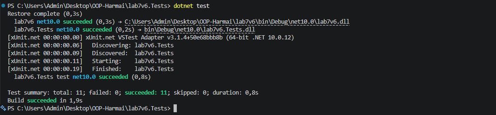

# Лабораторна робота №7: Узагальнені типи (Generics) та xUnit Тестування

##  Тема
Узагальнені типи (Generics). `IRepository` з `where`-обмеженнями та тестами.

## Мета роботи
Навчитися створювати узагальнені інтерфейси та класи, застосовувати `where`-обмеження для типів-параметрів, а також розробляти автоматизовані юніт-тести xUnit для перевірки коректності узагальнених реалізацій.

##  Індивідуальний варіант №6
**Сутність `Employee`:** `Id` (int), `FirstName` (string), `LastName` (string), `Position` (string).

## Структура проєкту

* **`lab12v6`** — Консольний проєкт, що містить:
  * `IEntity` — базовий інтерфейс для сутностей з властивістю `int Id`.
  * `Employee` — сутність варіанту 6.
  * `IRepository<T>` — узагальнений інтерфейс CRUD-операцій (`where T : IEntity`).
  * `InMemoryRepository<T>` — узагальнена реалізація репозиторію в пам'яті.
* **`lab12v6.Tests`** — xUnit тестовий проєкт:
  * Покриває 100% методів `InMemoryRepository<T>` (`Add`, `GetById`, `GetAll`, `Update`, `Delete`), перевіряючи позитивні сценарії та обробку виняткових ситуацій (неіснуючі ID, дублікати, `null`).

##  Запуск тестів
```bash
cd lab12v6.Tests
dotnet test
