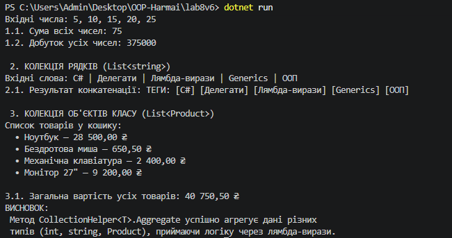

# Лабораторна робота №8: Делегати й лямбда-вирази у практиці колекцій

##  Тема
Делегати й лямбда-вирази у практиці колекцій: `CollectionHelper<T>`.

## Мета роботи
Навчитися передавати поведінку як параметр через делегати `Func`, `Action`, `Predicate`, будувати на цій основі універсальні операції над колекціями та використовувати лямбда-вирази у практиці ООП.

##  Індивідуальний варіант №6
**Метод узагальненого класу `CollectionHelper<T>`:** `Aggregate`
* **Сигнатура:** `public static TAccumulate Aggregate<TAccumulate>(IEnumerable<T> collection, TAccumulate seed, Func<TAccumulate, T, TAccumulate> func)`

## Короткий хід роботи (Що було зроблено)

 **Реалізація класу `CollectionHelper<T>`:**
   - Створено статичний узагальнений клас `CollectionHelper<T>`.
   - Реалізовано метод `Aggregate`, який приймає колекцію `IEnumerable<T>`, початкове значення `seed` та делегат `Func<TAccumulate, T, TAccumulate>`.
   - Метод реалізовано за допомогою власного циклу перебору `foreach` без використання готового LINQ-оператора `.Aggregate()`.

 **Демонстрація у `Program.cs`:**
   - Продемонстровано роботу узагальненого методу для трьох різних типів колекцій:
     - `List<int>`: обчислення суми та добутку чисел.
     - `List<string>`: об'єднання рядків із префіксом.
     - `List<Product>`: обчислення загальної сумарної вартості всіх товарів.
     