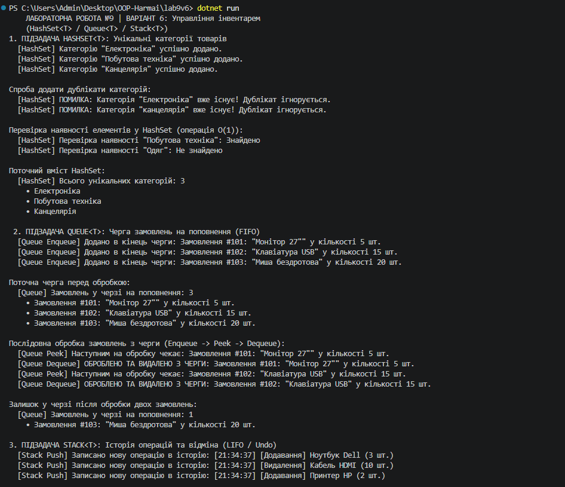
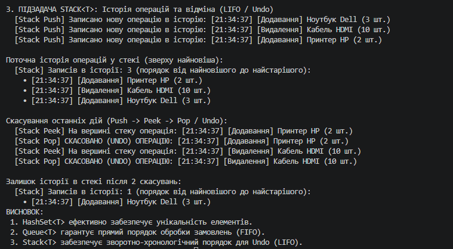

# Лабораторна робота №9: HashSet<T>, Queue<T>, Stack<T> — практичні сценарії

##  Тема
HashSet/Queue/Stack: практичні сценарії.

##  Мета роботи
Навчитися використовувати спеціалізовані колекції `HashSet<T>`, `Queue<T>`, `Stack<T>` для розв'язання практичних задач, зрозуміти їхні особливості та сценарії застосування (унікальність, FIFO, LIFO).

---

##  Індивідуальний варіант №6 (Управління інвентарем)
* **`HashSet<T>`:** Зберігання унікальних категорій товарів (забезпечення відсутності дублікатів з перевіркою за $O(1)$).
* **`Queue<T>`:** Черга замовлень на поповнення за принципом **FIFO** (`Enqueue`, `Peek`, `Dequeue`).
* **`Stack<T>`:** Історія виконаних операцій з можливістю скасування (Undo) за принципом **LIFO** (`Push`, `Peek`, `Pop`).

---

##  Короткий хід роботи (Що було зроблено)

 **Розробка сутностей та менеджера інвентарю:**
   - Описано класи `RestockOrder` та `InventoryAction`.
   - Створено клас `InventoryManager`, який агрегує три колекції та містить методи для роботи з ними.

 **Демонстрація в `Program.cs`:**
   - **`HashSet<string>`:** Продемонстровано додавання категорій, автоматичне відхилення дублікатів та миттєву перевірку `Contains`.
   - **`Queue<RestockOrder>`:** Продемонстровано додавання замовлень на поповнення та їхню послідовну обробку в порядку черги.
   - **`Stack<InventoryAction>`:** Продемонстровано фіксацію дій над товарами та зворотно-хронологічне скасування останніх операцій (Undo).

